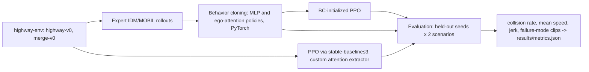

# Learned driving: behavior cloning vs PPO in highway-env

This project compares behavior cloning with PPO, using both an MLP and an ego-attention policy, on simulated highway and merge traffic. Expert demonstrations come from a discretized IDM + MOBIL planner. Held-out traffic seeds measure collision rate, speed, and jerk, and a short failure-mode note is saved with collision GIFs.

## Setup

```text
python -m venv .venv
.venv\Scripts\pip install -r requirements.txt
```

PyTorch is pinned to the CPU wheel. `requirements.txt` starts with `--extra-index-url https://download.pytorch.org/whl/cpu`.

## How to run

From this folder:

```text
python run.py
python run.py --quick
python run.py --device cpu
```

`python run.py` collects 4,000 expert transitions on each scenario, trains behavior cloning and PPO, and evaluates 200 held-out seeds per scenario. Cached files under `data/` and `artifacts/` are reused only when their checksum and configuration fingerprint match. `python run.py --quick` runs the same stages on a few episodes and finishes in a few minutes. It is the smoke test, not the reported result.

The full run is sized for this CPU. Decisions are at 1 Hz and the physics step is 5 Hz. Highway episodes last 12 seconds with 3 lanes and 4 other vehicles. `merge-v0` keeps the simulator's own ramp layout and vehicle count. The observation has 8 vehicle rows. Every PPO run, scratch and behavior-cloning initialization, trains for 50,176 environment steps. Rollouts use 4 worker processes. The policy is a 32-dimensional MLP or ego-attention encoder (MLP hidden width 64). Torch in the parent process is limited to 4 threads, and each worker uses 1. Those choices are the same for training and for the 200-seed evaluation. The success-criterion thresholds in `SPEC.md` are unchanged.

## Architecture



The kinematic observation is a matrix of up to 8 vehicles by 5 features: presence, x, y, vx, vy. Row 0 is the ego vehicle. The attention policy embeds each row and lets the ego query attend to the others, ignoring rows with presence 0. PPO uses that module as a stable-baselines3 feature extractor. The behavior-cloning action head is copied into PPO for the initialized runs. The value head is not copied.

## Design decisions

- Decisions run at 1 Hz and physics at 5 Hz. PPO rollouts are collected in 4 processes, so a full `python run.py` can give every PPO run 50,176 environment steps and still stay within about 50 minutes. Target speeds are every 1 m/s from 0 to 30. The setpoint is synced to measured speed before each action, so IDLE means "hold the current speed." FASTER and SLOWER then move that setpoint by 5 m/s. A 1 m/s step could not produce an IDM-sized brake, and the merge expert was running into slowing traffic. The expert presses SLOWER when IDM acceleration is below -1.5 m/s² and FASTER when it is above 0.8 m/s². When MOBIL asks for a lane change, that action is taken instead of the longitudinal one, on both highway-v0 and merge-v0. IDM's delta is fixed at 4 so the same scene has one label. MOBIL is queried once per second, including on the first step. The observation adds the same-lane gap, range rate, and neighbouring-lane gaps that IDM and MOBIL use, because the sorted kinematic matrix does not put that leader in a fixed row. Highway episodes last 12 seconds.
- Four other vehicles are spawned on highway-v0. The observation has 8 rows, so the scene fits in the network input, including empty padding rows. merge-v0 does not read `vehicles_count`; it uses the ramp scene shipped with highway-env.
- Neighbor search follows connected lane segments. That matters on `merge-v0`, where the ramp and the main road are different lane pieces.
- The expert is highway-env's own IDM and MOBIL, mapped onto `LANE_LEFT`, `IDLE`, `LANE_RIGHT`, `FASTER`, and `SLOWER`. A second baseline is IDM with lane changes disabled.
- Behavior cloning early-stops on a validation split of expert episodes. Actions that are under 20% of the labels, including braking and lane changes, get a class weight of at most 2. A much larger brake weight made the cloned policy brake on ordinary gaps. The policy that is reported on the test seeds is chosen on a separate block of environment seeds, using collision rate and speed against the validation expert. Test seeds are fixed in `src/config.py` and are not used for collection, training, or that choice.
- PPO from behavior cloning is compared with PPO from scratch on a third seed block (the learning-curve seeds). The reported step fraction is for the highway ego-attention pair: the first curve point, including step 0, whose mean return reaches the scratch run's final return, divided by the shared step budget.
- CPU threads are capped at 4. Training checkpoints live under `artifacts/` and can be resumed.

## Metrics

Collision rate is the percent of episodes that crash or leave the road. Mean speed is total distance divided by total time (the step-weighted mean of the recorded speeds). Jerk is the mean absolute second difference of speed inside each episode, then averaged across episodes. The speed criterion also requires the learned collision rate to be no worse than the expert by more than 2 percentage points on the same highway test seeds. Those checks are computed in `src/metrics.py` and stored by `python run.py` in `results/metrics.json`.

Raw rows are in `results/episodes.csv` (`episode_id` ties a row to a scenario, split, policy, and seed), `results/learning_curves.csv`, `results/bc_test_predictions.csv` (`transition_id` is the row in the expert `.npz`), and `results/split_assignments.csv`.

## Results

<!-- RESULTS_START -->
| Criterion | Value | Threshold | Passed |
|---|---:|---:|---|
| Collision rate (best learned policy) | 1.5000 | <= 8.0 | True |
| Mean speed vs. rule-based expert | 99.1409 | >= 95.0 | True |
| BC-initialized PPO vs. PPO from scratch | 0.0000 | <= 60.0 | True |
| merge-v0 collision rate (best learned policy) | 0.0000 | <= 10.0 | True |
| Test coverage of src/ | 86.6429 | >= 65.0 | True |

Held-out test metrics (time-weighted mean speed, collision percent):

| Scenario | Policy | Collision % | Mean speed (m/s) | Mean |jerk| | Mean return |
|---|---|---:|---:|---:|---:|
| highway | idm_mobil | 0.50 | 25.57 | 1.268 | 2.677 |
| highway | idm_lane_keep | 0.00 | 23.52 | 1.898 | 1.836 |
| highway | bc_mlp | 1.50 | 25.32 | 1.328 | 2.567 |
| highway | bc_attention | 1.50 | 25.35 | 1.562 | 2.578 |
| highway | ppo_mlp_scratch | 0.00 | 18.95 | 0.415 | 0.661 |
| highway | ppo_mlp_bc | 4.00 | 25.08 | 0.466 | 2.418 |
| highway | ppo_attention_scratch | 0.00 | 5.32 | 0.404 | 0.026 |
| highway | ppo_attention_bc | 1.50 | 23.44 | 0.794 | 2.009 |
| merge | idm_mobil | 0.00 | 19.63 | 0.804 | 10.779 |
| merge | idm_lane_keep | 0.00 | 19.17 | 0.844 | 10.628 |
| merge | bc_mlp | 0.00 | 19.65 | 0.746 | 10.786 |
| merge | bc_attention | 0.00 | 19.64 | 0.725 | 10.783 |
| merge | ppo_mlp_scratch | 0.00 | 5.62 | 0.270 | 6.917 |
| merge | ppo_mlp_bc | 0.00 | 19.81 | 0.635 | 10.675 |
| merge | ppo_attention_scratch | 0.00 | 5.62 | 0.270 | 6.917 |
| merge | ppo_attention_bc | 0.00 | 20.92 | 0.356 | 11.482 |

Each PPO run, from scratch and from behavior cloning, trains for 50176 environment steps. Held-out collision rates for the from-scratch runs are highway ppo_mlp_scratch 0.0%, highway ppo_attention_scratch 0.0%, merge ppo_mlp_scratch 0.0%, merge ppo_attention_scratch 0.0%. Their mean speeds are highway ppo_mlp_scratch 18.95 m/s, highway ppo_attention_scratch 5.32 m/s, merge ppo_mlp_scratch 5.62 m/s, merge ppo_attention_scratch 5.62 m/s. The sample-efficiency percentage is the share of that shared budget at which BC-initialized PPO first matches the scratch run's final learning-curve return. A low scratch return makes that percentage small, including when a scratch policy avoids collisions by driving well below the expert speed.

The reported policy for each scenario was chosen on validation episodes: highway bc_attention, merge ppo_mlp_bc.
<!-- RESULTS_END -->

Plots: `results/learning_curves.png`, `results/collision_rates.png`, `results/speed_comparison.png`. Collision GIFs are under `results/collisions/`. They use pygame's normal video driver. A dummy video driver writes black frames.

## Dataset and license

Rollouts are generated locally with [highway-env](https://github.com/Farama-Foundation/HighwayEnv) (MIT). stable-baselines3 is MIT. There is no external driving dataset. `data/<mode>/*.npz` is cached and checked with a SHA-256 manifest and a row count. If the configuration fingerprint changes, the file is collected again.

## Limitations

The action space is five meta-actions, not continuous steering. The horizon is 12 seconds. Each PPO arm has 50,176 environment steps, the same budget for behavior-cloning initialization and training from scratch. That budget supports the sample-efficiency comparison. It is not a claim that scratch PPO has converged. The results table states the measured from-scratch collision rates and speeds. On this run several scratch policies stay collision-free while driving slower than the expert, so matching their final return at 0% of the budget is not evidence that scratch has learned the expert's speed. `merge-v0` is the environment named in the spec. The attention block looks at the vehicles present at one time step. It is not a temporal transformer and it is not a graph net over the full road. Nothing here is a production driving stack or a real-vehicle result.

## Tests

```text
python -m pytest
```
