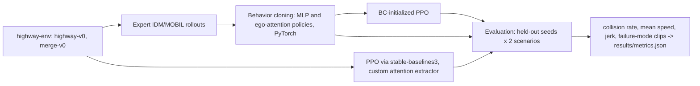

# Learned driving: behavior cloning vs PPO in highway-env

This project compares behavior cloning with PPO, using both an MLP and an ego-attention policy, on simulated highway and merge traffic. Expert demonstrations come from a discretized IDM + MOBIL planner. Held-out traffic seeds measure collision rate, speed, and jerk, and a short failure-mode note is saved with collision GIFs.

## Setup

```text
python -m venv .venv
.venv\Scripts\pip install -r requirements.txt
```

PyTorch is pinned to the CPU wheel. `requirements.txt` starts with `--extra-index-url https://download.pytorch.org/whl/cpu`.

## How to run

From this folder:

```text
python run.py
python run.py --quick
python run.py --device cpu
```

`python run.py` collects 100,000 expert transitions on each scenario (200,000 total), trains behavior cloning and PPO, and evaluates 200 held-out seeds per scenario. Cached files under `data/` and `artifacts/` are reused only when their checksum and configuration fingerprint match. `python run.py --quick` runs the same stages on a few episodes and finishes in a few minutes. It is the smoke test, not the reported result.

## Architecture



The kinematic observation is a matrix of up to 10 vehicles by 5 features: presence, x, y, vx, vy. Row 0 is the ego vehicle. The attention policy embeds each row and lets the ego query attend to the others, ignoring rows with presence 0. PPO uses that module as a stable-baselines3 feature extractor. The behavior-cloning action head is copied into PPO for the initialized runs. The value head is not copied.

## Design decisions

- Decisions and physics both run at 5 Hz. Target speeds are every 1 m/s from 0 to 30, and the setpoint is synced to measured speed before each action, so IDLE means "hold the current speed." The expert presses SLOWER when IDM acceleration is below -1.0 m/s² and FASTER when it is above 0.5 m/s². IDM's delta is fixed at 4 so the same scene has one label. The observation adds the same-lane gap, range rate, and neighbouring-lane gaps that IDM and MOBIL use, because the sorted kinematic matrix does not put that leader in a fixed row. Episodes last 20 seconds on the highway.
- Eight other vehicles are spawned. The observation has 10 rows, so the scene fits in the network input, including empty padding rows.
- Neighbor search follows connected lane segments. That matters on `merge-v0`, where the ramp and the main road are different lane pieces.
- The expert is highway-env's own IDM and MOBIL, mapped onto `LANE_LEFT`, `IDLE`, `LANE_RIGHT`, `FASTER`, and `SLOWER`. A second baseline is IDM with lane changes disabled.
- Behavior cloning early-stops on a validation split of expert episodes. The policy that is reported on the test seeds is chosen on a separate block of environment seeds, using collision rate and speed against the validation expert. Test seeds are fixed in `src/config.py` and are not used for collection, training, or that choice.
- PPO from behavior cloning is compared with PPO from scratch on a third seed block (the learning-curve seeds). The reported step fraction is for the highway ego-attention pair: the first curve point, including step 0, whose mean return reaches the scratch run's final return, divided by the shared step budget.
- CPU threads are capped at 4. Training checkpoints live under `artifacts/` and can be resumed.

## Metrics

Collision rate is the percent of episodes that crash or leave the road. Mean speed is total distance divided by total time (the step-weighted mean of the recorded speeds). Jerk is the mean absolute second difference of speed inside each episode, then averaged across episodes. The speed criterion also requires the learned collision rate to be no worse than the expert by more than 2 percentage points on the same highway test seeds. Those checks are computed in `src/metrics.py` and stored by `python run.py` in `results/metrics.json`.

Raw rows are in `results/episodes.csv` (`episode_id` ties a row to a scenario, split, policy, and seed), `results/learning_curves.csv`, `results/bc_test_predictions.csv` (`transition_id` is the row in the expert `.npz`), and `results/split_assignments.csv`.

## Results

<!-- RESULTS_START -->
Results are written here by `python run.py`.
<!-- RESULTS_END -->

Plots: `results/learning_curves.png`, `results/collision_rates.png`, `results/speed_comparison.png`. Collision GIFs are under `results/collisions/`.

## Dataset and license

Rollouts are generated locally with [highway-env](https://github.com/Farama-Foundation/HighwayEnv) (MIT). stable-baselines3 is MIT. There is no external driving dataset. `data/<mode>/*.npz` is cached and checked with a SHA-256 manifest and a row count. If the configuration fingerprint changes, the file is collected again.

## Limitations

The action space is five meta-actions, not continuous steering. The horizon is 20 seconds and the PPO budget is a few thousand steps per run, which is enough to compare sample efficiency and is not a claim that scratch PPO has converged. `merge-v0` is the environment named in the spec. The attention block looks at the vehicles present at one time step. It is not a temporal transformer and it is not a graph net over the full road. Nothing here is a production driving stack or a real-vehicle result.

## Tests

```text
python -m pytest
```
