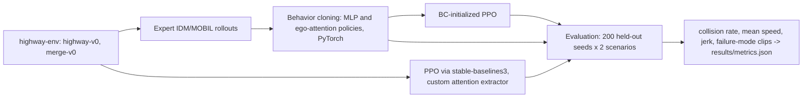

# Learned Driving Behavior - Behavior Cloning vs. PPO with an Attention Policy in highway-env

`rl-highway-planning` · new project · estimated build effort: 5 h

## Problem

Autonomous-driving teams combine imitation learning from logged behavior with reinforcement learning in simulation. This project uses highway-env to collect expert rollouts from a rule-based planner (IDM + MOBIL). It trains a behavior-cloning policy, then trains PPO from scratch and PPO initialized from behavior cloning, with an MLP and an ego-attention (transformer-style) policy over nearby vehicles. It evaluates collision rate, progress, and comfort on held-out traffic seeds across highway and merge scenarios, with a failure-mode analysis of the collisions.

## Target jobs and skills

- **Torc Robotics — Machine Learning Engineer II - Learned Planning (Reinforcement Learning)** (`d0aaa90ca942`): covers 88% of the JD's weighted top skills (Reinforcement Learning, Imitation Learning, PyTorch, Python, Transformers, Deep Learning, Autonomous Driving, Simulation, Model Evaluation)

Skills/tools this project demonstrates: Python, PyTorch, Reinforcement Learning, Imitation Learning, Autonomous Driving, Simulation, Deep Learning, Transformers, Model Evaluation

## Data

- **Dataset:** highway-env simulator (generated rollouts) — https://github.com/Farama-Foundation/HighwayEnv
- **License/terms:** MIT (highway-env), MIT (stable-baselines3)
- **Size used:** 4,000 expert transitions per scenario, generated locally; evaluation on 200 held-out seeds per scenario. The environment is the fast setting documented in the README (1 Hz decisions, 12 s episodes, 4 other highway vehicles). Each PPO run uses at least 50,000 environment steps.
- **Plan:** Training and evaluation use disjoint random seeds; evaluation seeds are fixed in a config file.

## Architecture

## Tech stack

Python 3.11, highway-env, gymnasium, stable-baselines3, PyTorch (CPU), NumPy, matplotlib, pytest

## Deliverables

- Expert data collector and dataset statistics
- BC trainer and a custom ego-attention feature extractor usable by SB3
- PPO training scripts (same environment-step budget for both PPO arms, sized to finish with the rest of `python run.py` in under 50 minutes on CPU) with checkpoints
- Evaluation harness with per-scenario metrics and a short failure-mode analysis (saved GIFs of 3 collisions)

## Success criteria (all must hold on a from-scratch `python run.py`)

| Metric | Threshold | How it is measured |
|---|---|---|
| Collision rate (best learned policy | <= 8% over 200 held-out seeds | evaluation harness |
| Mean speed vs. rule-based expert | >= 95% of expert at a collision rate no worse than expert + 2 pts | same seeds |
| BC-initialized PPO vs. PPO from scratch | reaches the scratch run's final return in <= 60% of the environment steps | learning curves |
| merge-v0 collision rate (best learned policy) | <= 10% | 200 held-out seeds |
| Test coverage of src/ | >= 65% | pytest --cov |

## Baseline

The rule-based IDM + MOBIL planner that generated the expert data, plus a constant-lane IDM-only policy.

## Constraints

- Runs on Windows with `python run.py` from a fresh virtualenv; no make, shell scripts, paid APIs, or accounts.
- CPU-only by default (an optional `--device cuda` flag is fine); peak RAM <= 3 GB; total downloads <= 1.5 GB.
- PyTorch (if used) pinned to the CPU wheel via `--extra-index-url https://download.pytorch.org/whl/cpu`.
- Fixed random seeds; every reported number is written by code to results/metrics.json (never typed by hand).
- Test split is created once, saved, and never used for training, tuning, or threshold selection.
- Data download is scripted (Python requests), cached under data/, and verified by checksum or row count.
- Total `python run.py` compute is sized for under 50 minutes on CPU; long runs checkpoint and resume. Success-criterion thresholds below are unchanged.

## Draft resume bullets (placeholders are filled only with reproduced metrics)

- Trained behavior-cloning and PPO driving policies in highway-env with an ego-attention network over nearby vehicles, cutting collision rate to [COLL] on 200 held-out traffic seeds
- Initialized PPO from behavior cloning to reach the from-scratch return in [STEP_PCT] of the environment steps
- Built an evaluation harness for collision rate, speed, and jerk across highway and merge scenarios, with a failure-mode analysis of remaining collisions
